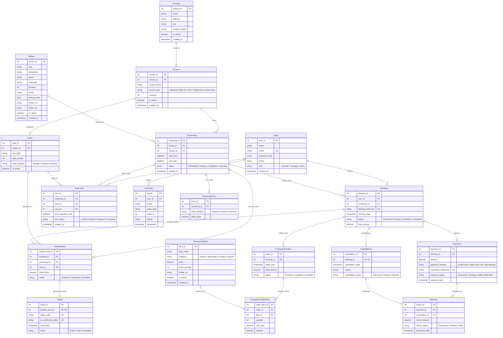

# CinePulse — Cinema Screening & Ticket Booking System
### A Full-Stack DBMS Academic Capstone Project in Third Normal Form (3NF)

Video Presentation: https://drive.google.com/drive/u/7/folders/1Dyfo8zA8ThAIm0azFvDZ7uODIuG6ar9h

[](https://python.org)
[](https://fastapi.tiangolo.com)
[](https://react.dev)
[](https://tailwindcss.com)
[](https://mysql.com)
[-success?style=for-the-badge)]()

---

## 📑 Table of Contents
1. [Project Overview](#1-project-overview)
2. [Key DBMS & Application Features](#2-key-dbms--application-features)
3. [Technology Stack](#3-technology-stack)
4. [System Architecture & Entity-Relationship (ER) Diagram](#4-system-architecture--entity-relationship-er-diagram)
5. [The 18 Normalized Relational Tables (3NF)](#5-the-18-normalized-relational-tables-3nf)
6. [Normalization Proof (1NF, 2NF, 3NF)](#6-normalization-proof-1nf-2nf-3nf)
7. [The Three Dedicated Portals & Credentials](#7-the-three-dedicated-portals--credentials)
8. [Concurrency Control & ACID Transactions](#8-concurrency-control--acid-transactions)
9. [Conflict Prevention Engine](#9-conflict-prevention-engine)
10. [The 8 SQL Analytical Reports](#10-the-8-sql-analytical-reports)
11. [Installation & Local Setup](#11-installation--local-setup)
12. [Docker & Cloud Deployment](#12-docker--cloud-deployment)
13. [REST API Documentation](#13-rest-api-documentation)
14. [DBMS Viva Voce Examination Cheatsheet](#14-dbms-viva-voce-examination-cheatsheet)

---

## 1. Project Overview

**CinePulse** is an enterprise-grade, commercial cinema screening and online ticket reservation platform inspired by industry leaders such as *BookMyShow* and *District*. Built specifically as a comprehensive Database Management Systems (DBMS) capstone project, CinePulse models real-world multiplex operations with strict relational data integrity, zero redundancy, and full ACID transaction guarantees.

The platform eliminates booking collisions using a distributed-style seat locking mechanism with Time-To-Live (TTL) expiration, enforces auditorium turnaround buffers during scheduling, and features three tailored portals for **Customers**, **Cinema Managers**, and **System Administrators**.

---

## 2. Key DBMS & Application Features

* **Rigorous 3NF Relational Architecture:** 18 fully normalized tables with primary, foreign, unique, and check constraints ensuring atomic storage and zero data anomalies.
* **180+ Real Blockbusters Across All Major Woods:** Pre-seeded with 184 films from Tollywood (Telugu), Bollywood (Hindi), Hollywood (English), Kollywood (Tamil), Mollywood (Malayalam), and Sandalwood (Kannada) with release dates, authentic descriptions, trailer URLs, and genre classification.
* **Pan-India Coverage (190+ Cities):** Complete BookMyShow-style city modal covering metro hubs and tier-2/3 cities across all 28 Indian States and 8 Union Territories with state filters and instant live search.
* **Dynamic Multiplex Seat Layouts:** Interactive visual seating grids categorized into **Regular**, **Premium**, and **Recliner** sections with live price calculation and occupancy states.
* **Concurrency Control with 5-Minute TTL Seat Locks:** Prevents two users from selecting or purchasing the same seat at the same time. Competing requests receive immediate `HTTP 409 Conflict` notifications.
* **Atomic Payment & Rollback Engine:** ACID transaction management guarantees complete database rollback if simulated payment verification fails or expires.
* **Overlap Conflict Prevention Engine:** Cinema managers cannot schedule overlapping shows on the same auditorium screen; a mandatory 20-minute turnaround cleaning buffer is mathematically enforced.
* **Concession & F&B Ordering Suite:** In-seat snack ordering linked directly to customer bookings with live inventory deduction.
* **Digital E-Tickets with QR Verification:** Real-time generation of printable electronic boarding passes with unique cryptographically verifiable QR tokens.
* **8 Analytical SQL Reports:** Advanced DBMS reports utilizing aggregates (`SUM`, `AVG`, `COUNT`), window functions (`DENSE_RANK`), and grouping with 1-click live CSV export.

---

## 3. Technology Stack

| Layer | Technologies Used | Description |
| :--- | :--- | :--- |
| **Frontend** | React 19, Tailwind CSS v3.4, Vite, Lucide React, Recharts, QRCode Canvas | Modern dark-themed responsive single-page application |
| **Backend** | Python 3.9+, FastAPI, Pydantic, Uvicorn, Passlib (Bcrypt), Python-JOSE (JWT) | High-performance asynchronous REST API with modular routers |
| **Database** | MySQL 8.0+ / MariaDB & SQLite (Auto-Fallback) | Relational database engine with automatic schema initialization and seeder |
| **ORM & Driver** | SQLAlchemy Core & ORM, PyMySQL | Object Relational Mapper maintaining relational constraints |
| **Deployment** | Docker (Multi-stage build), Render (`render.yaml`) | Containerized production deployment with single-port unified serving |

---

## 4. System Architecture & Entity-Relationship (ER) Diagram

### 4.1 Visual Entity-Relationship Diagram (Crow's Foot Notation)



### 4.2 Cardinality & Structural Relationships

| Relationship | Cardinality | Explanation |
| :--- | :---: | :--- |
| **`Cinemas` ➔ `Screens`** | $1 : N$ | A single cinema multiplex operates multiple screening halls. |
| **`Screens` ➔ `Seats`** | $1 : N$ | Every screen has a fixed geometric seat configuration divided by rows and numbers. |
| **`Movies` ➔ `Screenings`** | $1 : N$ | A movie can be scheduled across multiple auditoriums at various showtimes. |
| **`Screens` ➔ `Screenings`** | $1 : N$ | A single screen hosts many non-overlapping showtimes throughout the day. |
| **`Screenings` ➔ `ScreeningPrices`** | $1 : N$ | Per-show pricing allows distinct rates for Regular, Premium, and Recliner seats. |
| **`Users` ➔ `Bookings`** | $1 : N$ | Registered customers can place multiple reservations over time. |
| **`Bookings` ➔ `BookedSeats`** | $1 : N$ | A single booking transaction can encompass one or more individual seats. |
| **`BookedSeats` ➔ `Tickets`** | $1 : 1$ | Every confirmed seat produces exactly one printable boarding pass with unique QR code. |
| **`Bookings` ➔ `ConcessionOrders`**| $1 : 0..1$ | Food and beverage orders are optionally tied to an active booking reference. |
| **`ConcessionOrders` ➔ `Items`** | $1 : N$ | Orders decompose into multiple line items with unit price and quantities. |
| **`Bookings` ➔ `Payments`** | $1 : 1..N$ | Tracks original transaction references, gateway responses, and audit records. |
| **`Bookings` ➔ `Cancellations`** | $1 : 0..1$ | A booking can be cancelled at most once, initiating a cancellation record. |
| **`Payments` ➔ `Refunds`** | $1 : 0..1$ | Approved cancellations link payments directly to issued gateway refunds. |
| **`SeatLocks` (Concurrency)** | $M : N$ (TTL) | Temporary reservation holds preventing simultaneous booking collisions. |

---

## 5. The 18 Normalized Relational Tables (3NF)

| # | Entity Name | Description | Key Constraints |
| :-: | :--- | :--- | :--- |
| **1** | `Users` | System actors across Customer, Manager, and Admin roles | `PK: user_id`, `UK: email` |
| **2** | `Cinemas` | Physical theater locations across Indian metros and cities | `PK: cinema_id` |
| **3** | `Screens` | Auditoriums (IMAX Laser, 4DX, Dolby Atmos, Gold Class) | `PK: screen_id`, `FK: cinema_id`, `UK: (cinema_id, screen_name)` |
| **4** | `Seats` | Physical seating matrix with categories and coordinates | `PK: seat_id`, `FK: screen_id`, `UK: (screen_id, row_label, seat_number)` |
| **5** | `Movies` | Film catalog, certifications, runtimes, posters, and trailers | `PK: movie_id` |
| **6** | `Screenings` | Show schedules with start and end turnaround times | `PK: screening_id`, `FK: movie_id, screen_id` |
| **7** | `ScreeningPrices`| Show-specific dynamic pricing per seat tier | `PK: price_id`, `FK: screening_id`, `UK: (screening_id, seat_category)` |
| **8** | `Bookings` | Customer reservations and overall transaction totals | `PK: booking_id`, `FK: user_id, screening_id`, `UK: booking_reference` |
| **9** | `BookedSeats` | Atomic seat bookings preventing double allocations | `PK: booked_seat_id`, `FK: booking_id, seat_id`, `UK: (screening_id, seat_id)` |
| **10** | `Tickets` | E-Tickets with cryptographic QR verification tokens | `PK: ticket_id`, `FK: booked_seat_id`, `UK: ticket_code`, `UK: qr_verification_token` |
| **11** | `ConcessionItems`| Food & beverage snack inventory | `PK: item_id` |
| **12** | `ConcessionOrders`| Snack orders attached to a verified booking | `PK: order_id`, `FK: booking_id` |
| **13** | `ConcessionOrderItems`| Order line items storing historic purchase price & quantity | `PK: order_item_id`, `FK: order_id, item_id` |
| **14** | `Payments` | Payment transactions, methods, and gateway references | `PK: payment_id`, `FK: booking_id`, `UK: transaction_reference` |
| **15** | `Cancellations` | Booking cancellations with customer reasons and timestamps | `PK: cancellation_id`, `FK: booking_id`, `UK: booking_id` |
| **16** | `Refunds` | Financial refund ledger records linked to payments | `PK: refund_id`, `FK: payment_id, cancellation_id` |
| **17** | `SeatLocks` | High-concurrency temporary reservation holds with TTL | `PK: lock_id`, `FK: screening_id, seat_id, user_id` |
| **18** | `AuditLogs` | Immutable append-only administrative security log | `PK: log_id`, `FK: user_id` |

---

## 6. Normalization Proof (1NF, 2NF, 3NF)

### 6.1 First Normal Form (1NF)
* **Rule:** All attribute values must be atomic; no multivalued attributes or repeating groups.
* **Implementation:**
  * Rather than storing a list of seats in a single string column (e.g., `"A1, A2, A3"`), individual seats are decomposed into atomic rows in `BookedSeats`.
  * Rather than listing multiple snacks inside a booking column, individual items are partitioned into `ConcessionOrderItems`.
  * Phone numbers, timestamps, and pricing attributes contain atomic scalar values.

### 6.2 Second Normal Form (2NF)
* **Rule:** Table must be in 1NF, and all non-prime attributes must be fully functionally dependent on the primary key (no partial dependencies on composite keys).
* **Implementation:**
  * In `ScreeningPrices(price_id, screening_id, seat_category, ticket_price)`, the ticket price depends on the composite candidate key `(screening_id, seat_category)`. By utilizing `price_id` as surrogate primary key, all attributes depend completely on the primary key.
  * In `Seats(seat_id, screen_id, row_label, seat_number, seat_category)`, `seat_category` depends on the seat itself, not partially on the screen.

### 6.3 Third Normal Form (3NF)
* **Rule:** Table must be in 2NF, and no non-prime attribute may depend transitively on the primary key ($X \to Y$ only when $X$ is a superkey or $Y$ is a prime attribute).
* **Implementation:**
  * In `Screenings`, movie duration and screen capacity are **not** replicated. Replicating them would cause the transitive dependency: $\text{screening\_id} \to \text{movie\_id} \to \text{duration}$. Only the foreign keys `movie_id` and `screen_id` are maintained.
  * In `Screens`, theater location and contact numbers are not stored; they are referenced through `cinema_id` pointing to `Cinemas`.
  * In `Bookings`, customer phone and screening dates are strictly referenced through `user_id` and `screening_id`.

---

## 7. The Three Dedicated Portals & Credentials

CinePulse features **three dedicated user workspaces** accessible through the top navigation bar with 1-click credential auto-fill:

| Portal | Dedicated Workspace | Email Address (Gmail Format) | Password | Permissions & Capabilities |
| :--- | :--- | :--- | :--- | :--- |
| 👤 **Customer Portal** | Patron Booking Suite | `customer@gmail.com` | `password123` | Browse 184+ blockbusters across 190+ cities, interactive seat layout, 5-min TTL locks, concession ordering, QR ticket downloads, and cancellations. |
| 🎬 **Manager Portal** | Cinema Operations Suite | `manager@gmail.com` | `password123` | Screening scheduler with 20-min cleaning buffer overlap engine, seat maintenance toggles, snack inventory pricing, and occupancy stats. |
| ⚙️ **Admin Portal** | Enterprise DBMS Control Room | `admin@gmail.com` | `password123` | Access to all 8 analytical SQL reports with interactive charts, immutable SQL audit logs, RBAC user role administration, and 1-click CSV streaming. |

---

## 8. Concurrency Control & ACID Transactions

```
Customer A (Clicks A1) ──► Acquire SeatLock (TTL: 300s) ──► HTTP 200 (Locked)
                                  │
Customer B (Clicks A1) ───────────┼───────────────────────► HTTP 409 Conflict (Locked by another user)
                                  ▼
                     Payment Gateway Simulation
                       ┌──────────┴──────────┐
                       ▼                     ▼
                  [ SUCCESS ]           [ FAILED / EXPIRED ]
                       │                     │
               db.begin() (ACID)      db.rollback()
               INSERT BookedSeats     Release SeatLock
               INSERT Ticket (QR)     Seats available again
               COMMIT & Send Ticket
```

1. **Temporary Reservation Locks (`SeatLocks`):** When a patron selects a seat, a lock tuple is inserted with an expiration timestamp (`datetime.utcnow() + timedelta(seconds=300)`).
2. **Double-Booking Rejection:** Any competing user attempting to select that seat is blocked by checking active locks and existing `BookedSeats`.
3. **Atomic Execution:** Confirming a booking executes within an isolated database transaction (`db.begin()`). The booking, booked seats, payment, and tickets are inserted atomically.
4. **Failure Rollback:** If payment simulation fails or an exception occurs, `db.rollback()` restores the database to its exact prior state.

---

## 9. Conflict Prevention Engine

To prevent operational overlap inside movie theaters, the screening scheduler implements a **turnaround buffer algorithm**:

$$\text{Existing Screening Starts} < (\text{New Start} + \text{Duration} + 20\text{ mins})$$
$$\text{AND}$$
$$(\text{Existing Start} + \text{Duration} + 20\text{ mins}) > \text{New Start}$$

Any proposed screening that violates this condition on the same screen is rejected by the backend with `HTTP 409 Conflict`, complete with the conflicting movie title and time slot.

---

## 10. The 8 SQL Analytical Reports

Every report executes genuine aggregate SQL queries and offers interactive Recharts graphs alongside a **1-click CSV Export**:

1. **Show Occupancy Report:** Real-time occupancy percentage per show calculated as `ROUND(COUNT(bs.booked_seat_id) / s.capacity * 100, 2)`.
2. **Movie Performance Report:** Ranks movies by tickets sold and gross box-office collection using the SQL `DENSE_RANK()` window function.
3. **Screen Utilization Report:** Compares scheduled screen runtime against total daily operating capacity (14-hour basis).
4. **Concession Sales Report:** Aggregate quantity sold, total snack revenue, and remaining stock inventory per item.
5. **Cancellation Report:** Detailed cancellation records grouped by movie, date, and stated reason.
6. **Refund Report:** Reconciles original payment amounts against refund deductions and gateway transaction references.
7. **Comprehensive Revenue Report:** Calculates daily gross booking revenue, subtracted refunds, and final net earnings.
8. **Customer Booking Frequency Report:** Customer ranking by total transactions, lifetime spend, and cancellation frequency.

---

## 11. Installation & Local Setup

### Prerequisites
* Python 3.9 or higher
* Node.js 18+ and npm
* MySQL 8.0+ *(Optional — automatically falls back to pre-seeded SQLite for instant zero-configuration demo)*

### Step 1: Clone the Repository
```bash
git clone https://github.com/sahasrareddy69/CINEMA-SCREENING-AND-TICKET-BOOKING-SYSTEM.git
cd CINEMA-SCREENING-AND-TICKET-BOOKING-SYSTEM
```

### Step 2: Set Up Backend Environment
```bash
# Create and activate python virtual environment
python3 -m venv backend/venv
source backend/venv/bin/activate    # On Windows: backend\venv\Scripts\activate

# Install dependencies
pip install -r requirements.txt
```

### Step 3: Run the Unified Server
```bash
# Start FastAPI backend (serves both API and prebuilt React frontend)
python -m uvicorn backend.main:app --host 127.0.0.1 --port 8000 --reload
```
* **Web Application:** [http://127.0.0.1:8000](http://127.0.0.1:8000)
* **Swagger API Docs:** [http://127.0.0.1:8000/docs](http://127.0.0.1:8000/docs)
* **System Health Check:** [http://127.0.0.1:8000/api/health](http://127.0.0.1:8000/api/health)

### (Optional) Step 4: Frontend Development Server with HMR
If you wish to modify the React code with Hot Module Replacement:
```bash
cd frontend
npm install
npm run dev
```
Open [http://localhost:5173](http://localhost:5173) in your browser.

---

## 12. Docker & Cloud Deployment

### Docker Multi-Stage Build
The project includes an optimized multi-stage `Dockerfile`:
```bash
# Build Docker image
docker build -t cinepulse-system .

# Run container
docker run -p 8000:8000 cinepulse-system
```

### 1-Click Render Deployment
The project includes a ready-to-deploy `render.yaml` specification:
1. Connect your GitHub repository to [Render.com](https://render.com).
2. Choose **Blueprint** deployment.
3. Render automatically executes the multi-stage Docker build and hosts the application on Oregon cloud infrastructure.

---

## 13. REST API Documentation

| Method | Endpoint | Description | Role Required |
| :--- | :--- | :--- | :--- |
| `POST` | `/api/auth/register` | Register a new customer account | Public |
| `POST` | `/api/auth/login` | Authenticate user & issue JWT | Public |
| `GET` | `/api/auth/demo-users` | Fetch 1-click test credentials | Public |
| `GET` | `/api/movies` | Filterable movie catalog (city, genre, search) | Public |
| `GET` | `/api/cinemas` | Cinema list with screens and locations | Public |
| `GET` | `/api/screenings/{id}/seats` | Real-time seat layout with lock status | Public |
| `POST` | `/api/seat-locks/acquire` | Acquire temporary 300s TTL seat lock | Customer |
| `POST` | `/api/bookings/create` | Atomic booking and payment transaction | Customer |
| `POST` | `/api/bookings/{id}/cancel` | Cancel booking and request refund | Customer |
| `POST` | `/api/manager/screenings` | Schedule show with collision check | Manager |
| `PUT` | `/api/manager/seats/{id}` | Toggle seat maintenance mode | Manager |
| `GET` | `/api/admin/reports/{report_type}` | Execute SQL analytical reports | Admin |
| `GET` | `/api/admin/reports/{type}/export` | Stream analytical CSV report | Admin |

---

## 14. DBMS Viva Voce Examination Cheatsheet

### Q1: Why is this schema certified in Third Normal Form (3NF)?
* **1NF:** Every column stores atomic scalar values (no multivalued sets or comma-delimited strings).
* **2NF:** All non-key attributes are fully functionally dependent on the entire candidate key, eliminating partial dependencies.
* **3NF:** No non-prime attribute transitively depends on a primary key ($X \to Y$ only where $X$ is a superkey). For instance, cinema location details are partitioned in `Cinemas` rather than being redundantly repeated in `Screens` or `Screenings`.

### Q2: How does the system handle high-concurrency race conditions during ticket booking?
1. **Application Layer TTL Lock (`SeatLocks`):** A temporary hold record is inserted with a 300-second expiration. Competing requests return `HTTP 409 Conflict`.
2. **Unique Relational Constraints:** A compound database constraint `UNIQUE(screening_id, seat_id)` prevents duplicate bookings even under millisecond-level parallel threads.
3. **Atomic Transaction Scope:** All modifications are enclosed within `db.begin()`. In the event of a simulated gateway failure, `db.rollback()` executes automatically.

### Q3: How is screening overlap mathematically prevented in the scheduler?
Before inserting a new screening into `Screenings`, the database executes an overlap validation query enforcing a **20-minute turnaround cleaning buffer**:
```sql
SELECT * FROM Screenings 
WHERE screen_id = :screen_id 
  AND status != 'Cancelled'
  AND start_time < :new_end_time_with_buffer 
  AND end_time > :new_start_time;
```
If any rows return, the transaction raises `HTTP 409 Conflict` and prevents creation.

---

## 👥 Contributors & Academic Credits
* **Project:** Cinema Screening & Ticket Booking System (CinePulse)
* **Academic Subject:** Database Management Systems (DBMS) Laboratory
* **Repository:** [https://github.com/sahasrareddy69/CINEMA-SCREENING-AND-TICKET-BOOKING-SYSTEM](https://github.com/sahasrareddy69/CINEMA-SCREENING-AND-TICKET-BOOKING-SYSTEM)
